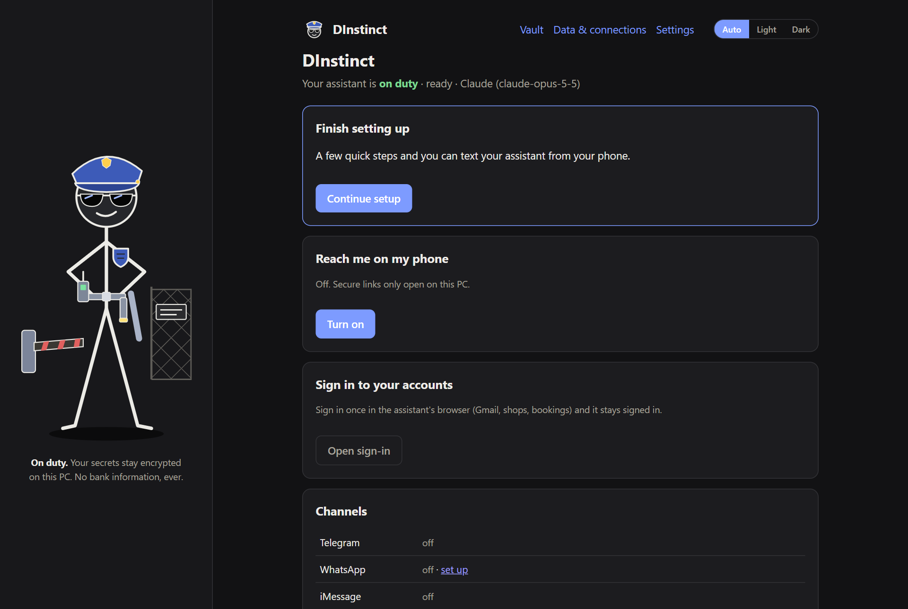
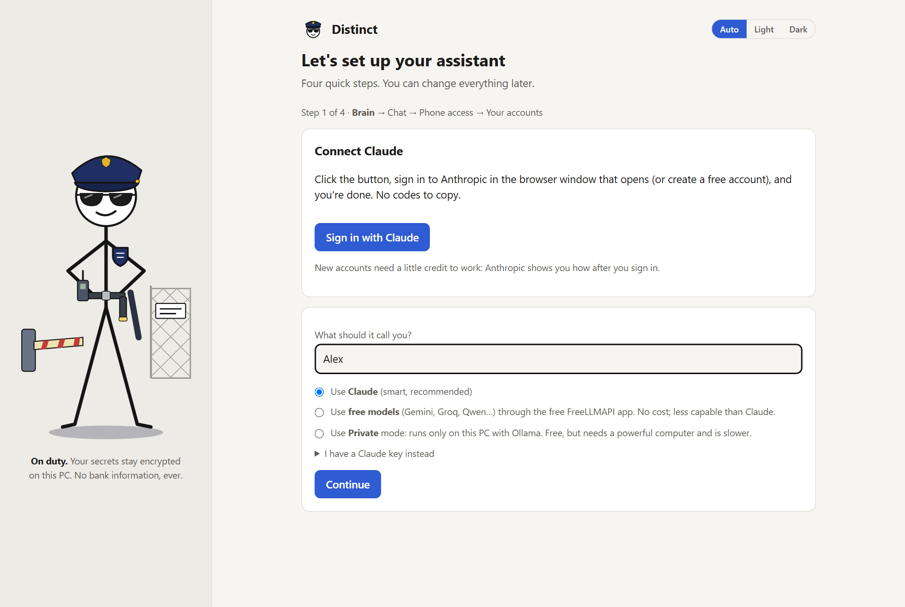
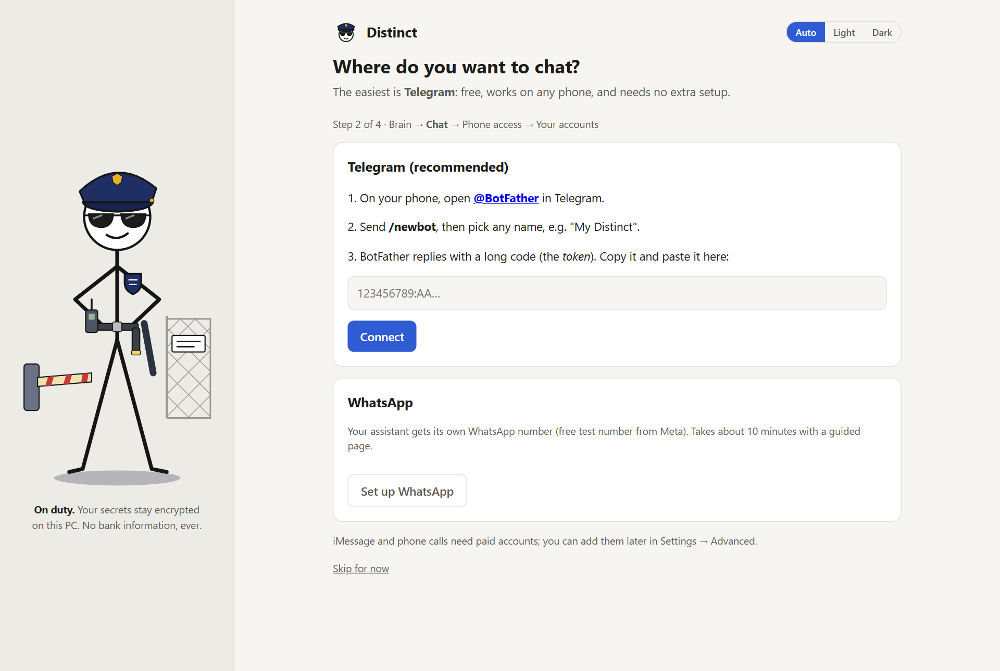
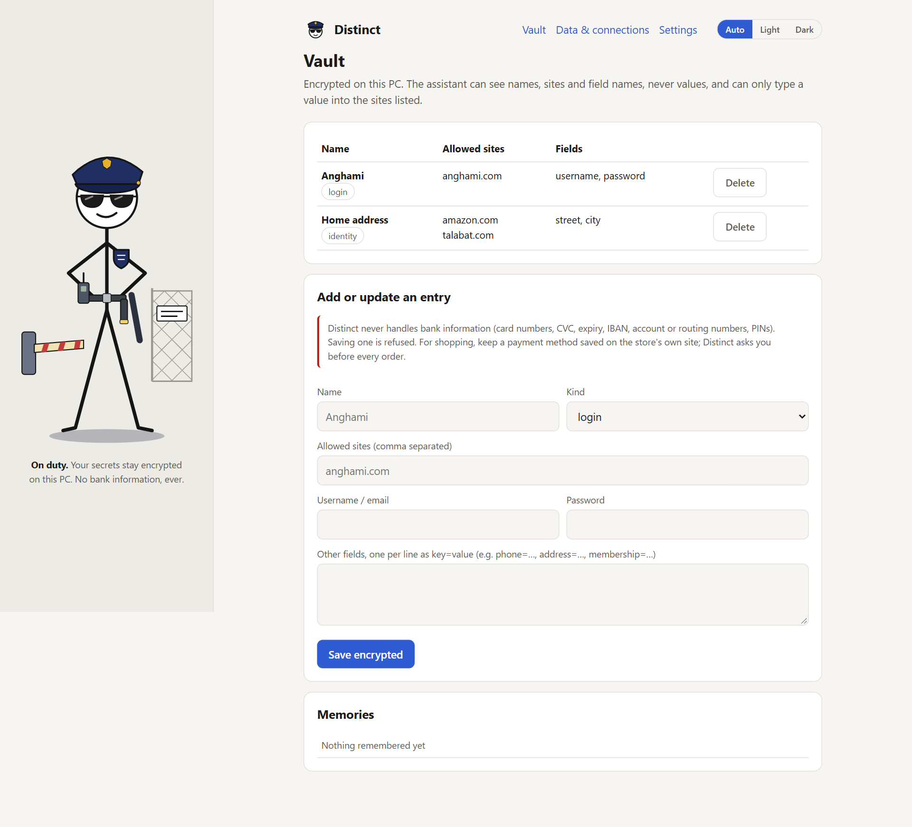
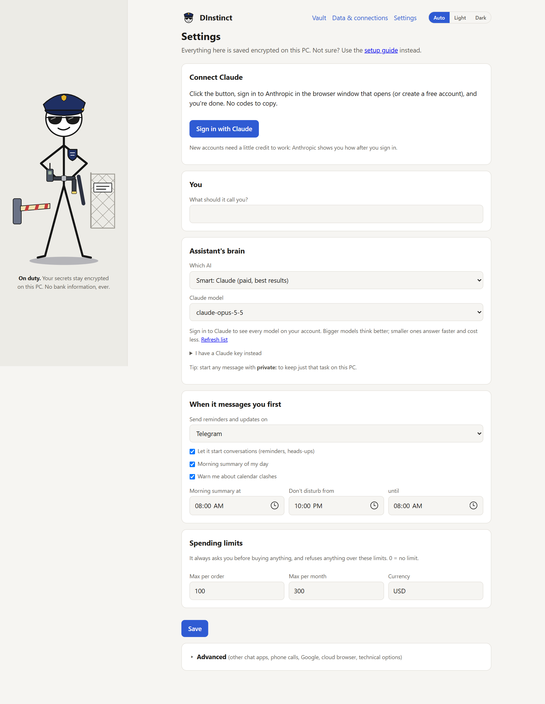
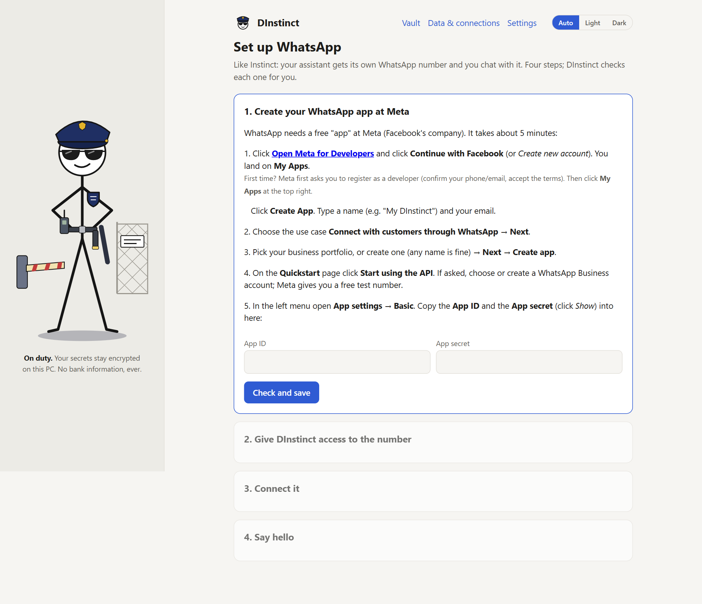
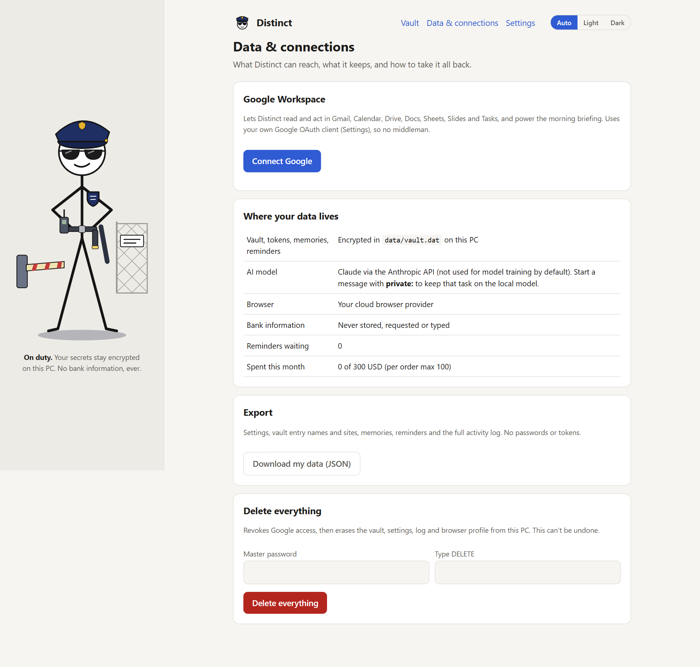
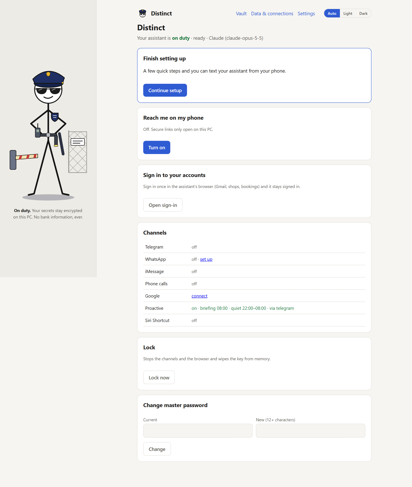
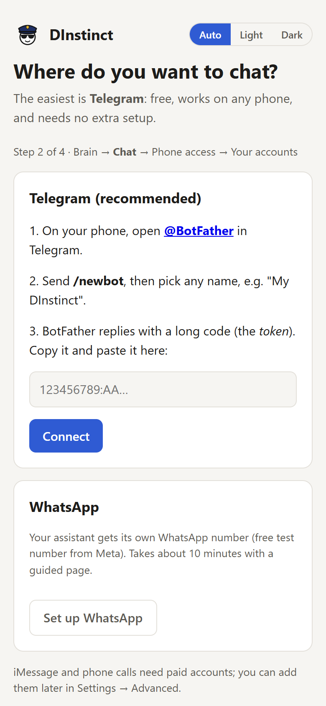

<p align="center">
  
</p>

<h1 align="center">DInstinct</h1>

<p align="center">
  <b>A private personal AI assistant you text on Telegram, WhatsApp, iMessage, by phone call or Siri.</b><br>
  It does real things on websites for you, and keeps every password <b>encrypted on your own PC</b>.
</p>

<p align="center">
  
  
  
  
</p>

<p align="center">
  <a href="https://claudioak.github.io/DInstinct/"><b>🌐 Website</b></a> &nbsp;·&nbsp;
  <a href="https://github.com/ClaudioAk/DInstinct/releases/latest/download/DInstinct.zip"><b>⬇ Download for Windows</b></a> &nbsp;·&nbsp;
  <a href="#quick-start"><b>Quick start</b></a>
</p>

---

DInstinct is an **agent**: give it a goal ("book a padel court for Saturday", "make me a playlist on Anghami", "chase the landlord about the deposit") and it plans, opens websites in its own browser, signs in with logins from your vault, asks you when it needs something, and finishes the job.

It follows the idea of hosted assistants like Instinct (you just text it, it uses a computer the way you do), but it is **self-hosted and private by design**: your vault, tokens, memories and logs live in one encrypted file on your machine, you choose the AI model, and bank information is refused in code.

> DInstinct is an independent open-source project. It is not affiliated with Instinct, Anthropic, Meta, Apple, Google, Telegram, Sendblue, Twilio, Cloudflare or FreeLLMAPI.

## Contents
- [Features](#features)
- [Screenshots](#screenshots)
- [Quick start (no technical knowledge needed)](#quick-start)
- [How your secrets stay safe](#how-your-secrets-stay-safe)
- [Choosing the AI](#choosing-the-ai)
- [Chat channels](#chat-channels)
- [Connected accounts and proactive messages](#connected-accounts-and-proactive-messages)
- [Privacy controls](#privacy-controls)
- [Company networks (firewalls)](#company-networks-firewalls)
- [Chat commands](#chat-commands)
- [Project layout](#project-layout)
- [Development and tests](#development-and-tests)
- [Security notes](#security-notes)
- [License](#license)

## Features

| | |
|---|---|
| 🤖 **Agent with a browser** | Researches, books, orders, fills forms and manages your accounts in its own browser (Edge on your PC, or a cloud browser such as Browserbase). |
| 🔐 **Encrypted local vault** | AES-256-GCM, key derived from your master password with scrypt. Passwords, API keys and tokens never leave the file in plain text. |
| 🙈 **The AI never sees secrets** | The model only sees entry *names*, *sites* and *field names*. Values are typed straight into the page, only on the entry's allowed sites. |
| 🔗 **Secure one-time links** | When a login is missing, it sends you a one-time link to add it, never asks in chat. |
| 🚫 **No bank information, ever** | Card numbers, CVC, IBAN, account/routing numbers and PINs are refused by the vault, never typed, and stripped from chat before the AI sees them. |
| 💬 **Text it anywhere** | Telegram (pair with a 6-digit code), WhatsApp (guided setup), iMessage (via Sendblue), phone calls (Twilio), Siri Shortcut. |
| ⏰ **Proactive** | Reminders, a morning briefing (agenda, clashes, bookings, important mail, unanswered emails) and calendar-clash alerts, with quiet hours. |
| 📧 **Google Workspace** | Gmail, Calendar, Drive, Docs, Sheets, Slides, Tasks through your own OAuth client. Sending and editing always ask YES first. |
| 🧠 **Your choice of AI** | Any Claude model (sign in with one click), free models via FreeLLMAPI, or a fully local model with Ollama. `private:` keeps a task on your PC. |
| 💳 **Spending limits** | Per-order and monthly limits checked before an order is even proposed; every purchase needs your YES. |
| 🧾 **Your data, your call** | Activity log, export (without secrets), and "delete everything". |
| 🌗 **Friendly UI** | Step-by-step setup guide, light/dark mode, and an "on duty" security guard who follows the theme. |

## Screenshots

| Setup guide | Telegram pairing |
|---|---|
|  |  |

| Encrypted vault | Settings |
|---|---|
|  |  |

| Guided WhatsApp setup | Data & privacy |
|---|---|
|  |  |

| Home (light) | On a phone |
|---|---|
|  |  |

## Quick start

**Requirements:** Windows 10/11 and Microsoft Edge (preinstalled). The installer adds Node.js if it's missing.

1. Download this repository (green **Code** button → **Download ZIP**) and unzip it, or `git clone` it.
2. Double-click **`Install DInstinct.cmd`**. It installs Node.js if needed, gets DInstinct's parts, puts a **DInstinct** icon on your desktop, and can start it with Windows.
3. A page opens at `http://127.0.0.1:7777`. Choose a **master password** (12+ characters; it can't be recovered).
4. The **setup guide** walks you through four short steps:
   - **Brain:** click **Sign in with Claude** (no key to copy), or pick **Free models** or **Private**.
   - **Chat:** create a Telegram bot with @BotFather (3 steps shown), paste its token, then tap the link and *Start*. A 6-digit code pairs your phone.
   - **Phone access:** one **Turn on** button so secure links open on your phone.
   - **Your accounts:** one button opens the assistant's browser; sign in to your sites once.

That's it: text your bot. Everything else (WhatsApp, iMessage, calls, Google, cloud browser) is under **Settings → Advanced**.

<details>
<summary>Manual start (developers)</summary>

```powershell
git clone https://github.com/ClaudioAk/DInstinct.git
cd DInstinct
npm install
npm start
```
`npm start` runs `node --use-system-ca --use-env-proxy src/main.ts` (Node 24+ runs TypeScript directly; no build step).
</details>

## How your secrets stay safe

| | Typical hosted assistant | DInstinct |
|---|---|---|
| Where passwords live | The provider's servers | `data/vault.dat` on your PC |
| Encryption | Not visible to you | AES-256-GCM, key from your master password (scrypt N=2¹⁷); header bound as AAD so tampering is detected |
| Can the AI read them? | Often optional | **Never**: the model sees names, sites and field names only |
| Where a secret can be typed | Sites you allow | Only into an `<input>` on the entry's allowed sites (subdomains included), never into payment fields |
| Bank / card data | Stored for purchases | **Never** stored, requested or typed |
| API keys and bot tokens | n/a | Inside the same encrypted vault |

More protections:
- Pages the AI reads have password fields and vault-filled fields masked; screenshots black them out.
- Admin pages (vault, settings) answer **only on this PC** (loopback address, no tunnel headers, Host check against DNS rebinding, CSRF token, strict Content-Security-Policy).
- Through the secure tunnel only these exist: `/fill/<one-time token>`, `/wa/webhook` (Meta-signed), `/imessage/webhook/<secret>`, `/voice/*` (Twilio-signed) and `/iphone` (bearer token).
- Only your own Telegram id / WhatsApp number / iMessage handle / phone number is answered.
- Website and email text is treated as **untrusted data**, never as instructions (prompt-injection defence).
- Sending email, calendar changes, document edits and purchases need your **YES**, enforced in code.
- `data/audit.log` records every action, never secret values. **Lock** stops everything and wipes the key from memory.

## Choosing the AI

| Option | Cost | Privacy | How |
|---|---|---|---|
| **Claude** (recommended) | Pay-as-you-go | Messages go to Anthropic's API (not used for training by default) | **Sign in with Claude**: DInstinct installs Anthropic's official `ant` tool and opens the normal sign-in page. Or paste an API key. |
| **Free models** | Free | Goes to the free providers you add (check their terms) | Install [FreeLLMAPI](https://freellmapi.co) from the Microsoft Store, add free keys (Gemini, Groq…), paste its key. |
| **Private** | Free | Never leaves your PC | Install [Ollama](https://ollama.com) and pull a model; needs a strong PC. |

- **Any Claude model:** Settings lists every model your account can use (live from Anthropic). DInstinct reads each model's capabilities and adapts the request (adaptive thinking and effort only where supported), so older and newer models both work.
- **`private:`** at the start of a message keeps that one task on the local model.

## Chat channels

| Channel | What you need | Setup |
|---|---|---|
| **Telegram** (easiest) | A free bot from @BotFather | Setup guide → paste token → tap link → paired by code |
| **WhatsApp** | A free Meta developer app (test number included) | **Set up WhatsApp** page: paste App ID + App secret, then the access token; DInstinct finds the number, registers its webhook (Graph API v27.0, `override_callback_uri`) and pairs you by code |
| **iMessage** | A [Sendblue](https://sendblue.com) account (paid; no Mac needed) | Settings → Advanced → iMessage; add the receive webhook shown on the home page |
| **Phone calls** | A [Twilio](https://twilio.com) number | Set "A call comes in" to `https://<public-url>/voice/incoming`; paste the auth token |
| **Siri Shortcut** | An iPhone | *Dictate Text* → *Get Contents of URL* (POST JSON `{text}` with `Authorization: Bearer <token>`) → *Speak Text* |

**Phone access (secure tunnel):** WhatsApp, iMessage, calls and opening one-time links on your phone need your PC to be reachable. The **Reach me on my phone** switch installs and runs a free Cloudflare quick tunnel and updates every webhook automatically when its address changes. Use your own fixed URL in Advanced if you prefer.

## Connected accounts and proactive messages

**Google Workspace:** create an OAuth client (*Web application*, redirect `http://127.0.0.1:7777/google/callback`) in Google Cloud, paste the client ID and secret in Settings, then **Data & connections → Connect Google**. Data is read on demand, never copied or indexed.

**Proactive:** pick a primary channel and quiet hours in Settings.
- **Reminders:** "remind me to cancel the gym trial on Friday at 5".
- **Morning briefing:** today's agenda, calendar clashes, bookings coming up ("still going?"), important unread mail, and emails you sent 3–14 days ago that nobody answered.
- **Clash alerts** during the day. Nothing is announced twice.

## Privacy controls
- **Private mode** (`private:` / `خاص:`), **spending limits** (per order and per month), **Data & connections** page (see what's connected, disconnect Google, export without secrets, delete everything with your master password).
- No telemetry. Nothing is sent anywhere except the AI provider you chose, the sites the assistant visits for you, and the chat services you connected.

## Company networks (firewalls)
Some workplace firewalls (Fortinet, Zscaler, Sophos…) inspect secure connections with their own certificate. DInstinct starts Node.js with `--use-system-ca --use-env-proxy` so it trusts Windows' certificates and uses the system proxy, explains a blocked connection in plain words (it names the firewall), and lets you paste the firewall's certificate under **Settings → Advanced → Company network certificate**. The cleanest fix is to ask IT to exclude `api.anthropic.com` from SSL inspection.

## Chat commands
| Command | What it does |
|---|---|
| `STOP` | Cancel the current task |
| `NEW` | Start a fresh conversation |
| `MODEL` / `model sonnet` | List models / switch model |
| `private: …` | Run this task on the local model only |
| `YES` / `نعم` / `ايوه` | Approve a purchase, email or change |

## Project layout
```
src/
  main.ts            start-up, company certificate
  app.ts             wires vault, agent, channels, tunnel, pairing
  core.ts            the agent loop, one owner session across channels
  tools.ts           browser / vault / approval tools (no tool returns a secret)
  vault.ts           encrypted vault (scrypt + AES-256-GCM)
  policy.ts          "no bank information" rule (field names, Luhn, IBAN checks)
  browser.ts         Playwright: local Edge, Browserbase or any CDP cloud browser
  web.ts             local web UI, setup guide, webhooks
  google.ts          Gmail, Calendar, Drive, Docs, Sheets, Slides, Tasks
  proactive.ts       reminders, morning briefing, clash alerts
  tunnel.ts          one-click Cloudflare quick tunnel
  claude-login.ts    "Sign in with Claude" via Anthropic's ant CLI
  netcheck.ts        firewall diagnosis and company certificates
  art.ts             the security guard drawing (theme-aware SVG)
  llm/               claude.ts, freellm.ts (OpenAI-compatible), ollama.ts
  channels/          telegram, whatsapp (+ guided setup), imessage, phone
test/                29 tests (node:test), no network or API cost
docs/images/         screenshots (demo data)
```

## Development and tests
```powershell
npm test
```
The suite uses fake models and simulated services (Meta Graph API, Sendblue, Twilio, FreeLLMAPI), so it needs no accounts or network. It covers encryption at rest, wrong passwords and tampering, site-locked fills, the AI never seeing secrets, the bank rule, purchase approval and spending limits, WhatsApp/Twilio/iMessage webhook authentication, pairing, the setup guide, Google tool confirmations, proactive messages and data deletion.

Set `DINSTINCT_DATA` to a temporary folder to run a throwaway instance without touching your real vault.

## Security notes
- DInstinct is a **single-user, personal** assistant. Run it on a PC you trust and keep the master password safe.
- An AI agent with a browser can make mistakes. Keep spending limits low and read confirmation messages before replying YES.
- With a cloud browser, a vault value is sent to that browser at the moment it is typed into one of the entry's allowed sites.
- Free model providers may use prompts to improve their models; use Claude or `private:` for sensitive tasks.
- Please report security issues privately (see [SECURITY.md](SECURITY.md)).

## License
[MIT](LICENSE)
